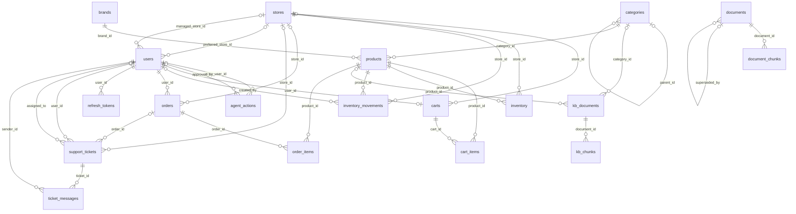
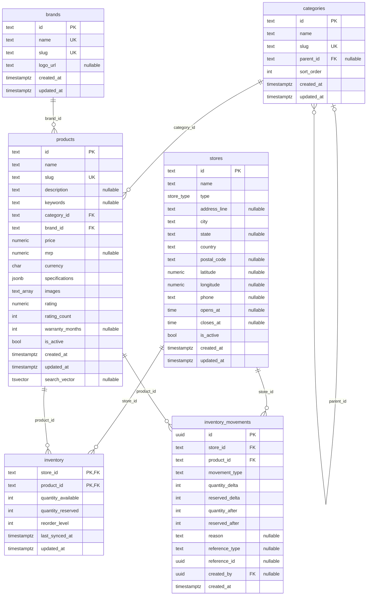
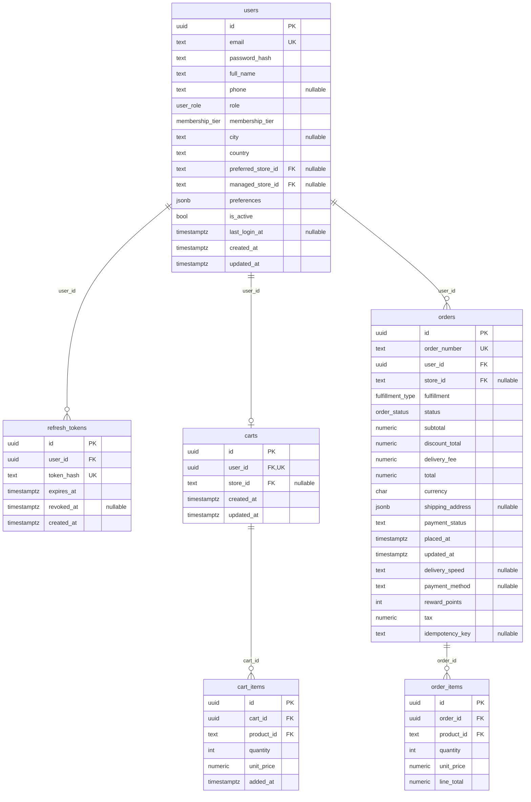
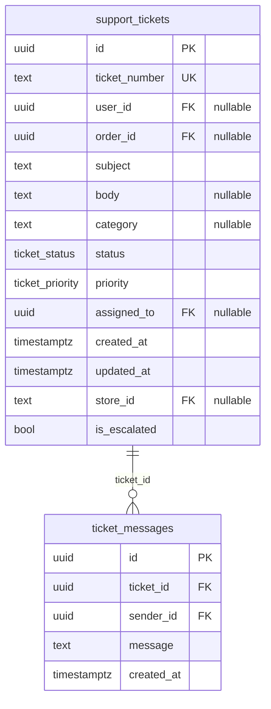
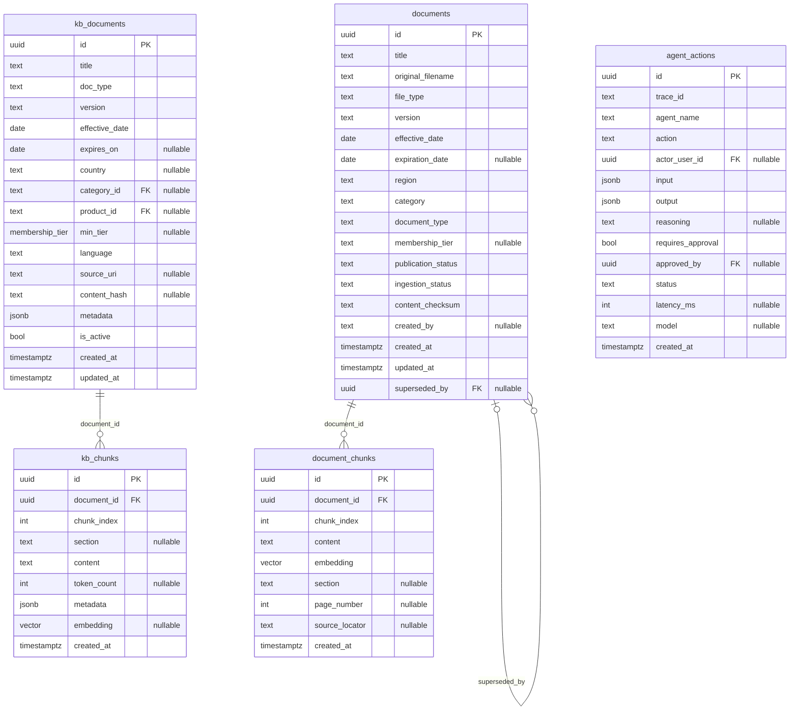

# Database: entity-relationship diagram

Generated by `npm run db:er` (in `backend/`) from the live schema at `aws-0-ap-southeast-1.pooler.supabase.com`. Do not edit by hand - re-run the script after a migration.

19 tables, 32 foreign keys, 4 views. The migrations in `backend/db/migrations/` are the source of truth.

Pre-rendered images of each diagram are in [`docs/er/`](er/), for viewers that do not draw Mermaid.

Reading the lines: `||--o{` is one-to-many, `||--o|` is one-to-at-most-one, and a `|o` end means the link is optional (the foreign key may be null). The label is the foreign-key column.

## Overview: every table and relationship

## Catalogue and inventory

Products belong to one brand and one category (categories nest). Stock is kept per store and product; every change is appended to `inventory_movements`.

Links to other groups: `inventory_movements.created_by` → `users`.

## Users, cart and orders

One cart per user. Checkout turns cart lines into an order with its own lines and takes stock from one store.

Links to other groups: `users.preferred_store_id` → `stores`, `users.managed_store_id` → `stores`, `carts.store_id` → `stores`, `cart_items.product_id` → `products`, `orders.store_id` → `stores`, `order_items.product_id` → `products`.

## Support

Tables only - there is no support API yet.

Links to other groups: `support_tickets.user_id` → `users`, `support_tickets.order_id` → `orders`, `support_tickets.assigned_to` → `users`, `support_tickets.store_id` → `stores`, `ticket_messages.sender_id` → `users`.

## Knowledge base and agent audit

`kb_documents` / `kb_chunks` were created by the backend and are unused. `documents` / `document_chunks` are owned and filled by `ai-service` (the RAG pipeline). `agent_actions` is the audit log for agent decisions.

Links to other groups: `kb_documents.category_id` → `categories`, `kb_documents.product_id` → `products`, `agent_actions.actor_user_id` → `users`, `agent_actions.approved_by` → `users`.

## Tables at a glance

| Table | Rows | Primary key | References |
|---|---:|---|---|
| `agent_actions` | 0 | id | users |
| `brands` | 34 | id | — |
| `cart_items` | 0 | id | carts, products |
| `carts` | 0 | id | users, stores |
| `categories` | 16 | id | categories |
| `document_chunks` | 87 | id | documents |
| `documents` | 9 | id | documents |
| `inventory` | 3280 | store_id, product_id | stores, products |
| `inventory_movements` | 0 | id | stores, products, users |
| `kb_chunks` | 0 | id | kb_documents |
| `kb_documents` | 0 | id | categories, products |
| `order_items` | 0 | id | orders, products |
| `orders` | 0 | id | users, stores |
| `products` | 328 | id | categories, brands |
| `refresh_tokens` | 9 | id | users |
| `stores` | 10 | id | — |
| `support_tickets` | 0 | id | users, orders, stores |
| `ticket_messages` | 0 | id | support_tickets, users |
| `users` | 12 | id | stores |

## Views

- `product_images`
- `v_low_stock`
- `v_product_availability`
- `v_product_catalog`
